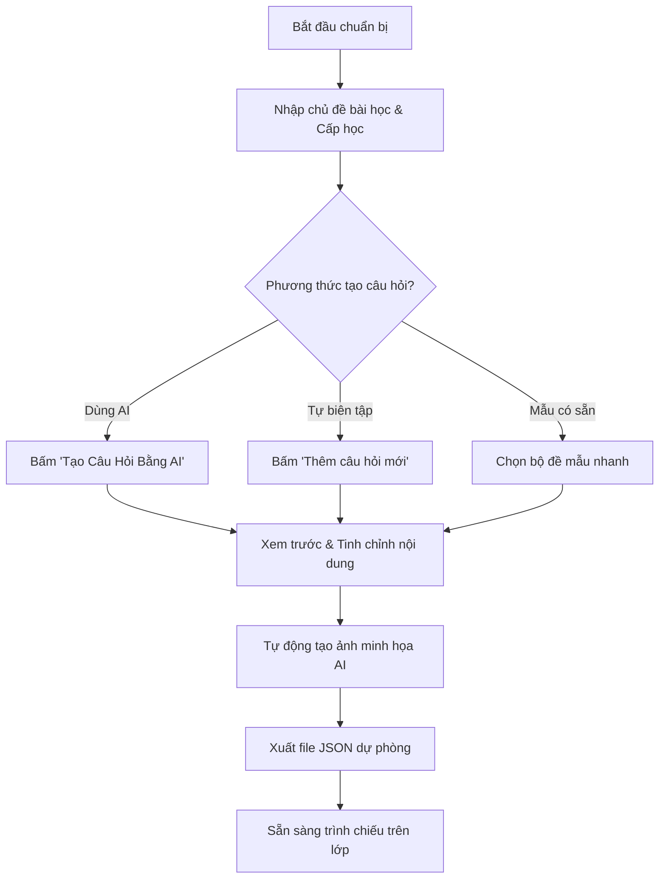

# 👩‍🏫 Quy Trình Vận Hành Dành Cho Giáo Viên (Teacher Flow)

Tài liệu này mô tả chi tiết quy trình chuẩn bị bài giảng, tạo nội dung tương tác và tổ chức hoạt động lớp học với nền tảng **EduPlay AI**.

---

## 🎯 1. Chuẩn Bị Trước Giờ Học (Preparation Phase)

### Bước 1: Khởi động Bảng Điều Khiển (Teacher Dashboard)
- Giáo viên truy cập vào tab **"Bảng Điều Khiển"** trên màn hình.
- Nhập **Tên bài học / Chủ đề** (ví dụ: *"Các Hành Tinh Trong Hệ Mặt Trời"*, *"Động vật hoang dã Châu Phi"*, *"Từ vựng Tiếng Anh Unit 5"*).
- Chọn **Độ tuổi / Cấp học** (Mầm non, Tiểu học, THCS) và **Số lượng câu hỏi** mong muốn.

### Bước 2: Tạo Ngân Hàng Câu Hỏi Tự Động
- **Sử dụng AI thông minh:** Bấm nút **"🤖 Tạo Câu Hỏi Bằng AI"**. Hệ thống gửi prompt tối ưu đến dịch vụ AI và trả về danh sách câu hỏi 4 lựa chọn có đáp án đúng, gợi ý và từ khóa ảnh minh họa.
- **Sử dụng Bộ Đề Mẫu (Quick Presets):** Nếu không có kết nối internet hoặc muốn thử nhanh, giáo viên có thể chọn các bộ đề mẫu biên soạn sẵn (Toán vui, Khám phá Tự nhiên, Từ vựng Anh ngữ).
- **Thêm/Sửa câu hỏi thủ công:** Giáo viên có thể nhấp đúp vào bất kỳ câu hỏi nào để chỉnh sửa nội dung, đáp án hoặc thêm câu hỏi mới theo ý thích.

### Bước 3: Kiểm tra Hình Ảnh Trực Quan
- Với mỗi câu hỏi, hệ thống tự động sinh ảnh minh họa bằng AI theo phong cách minh họa giáo dục (Cute 3D illustration / Watercolor style).
- Giáo viên có thể đổi từ khóa tạo ảnh nếu muốn minh họa khác.

---

## 🏫 2. Tổ Chức Giờ Học Trên Lớp (In-Class Interaction)

### Bước 4: Thiết lập Đội Nhóm
- Chia lớp thành 2 - 4 đội (Đội Đỏ, Đội Xanh, Đội Vàng, Đội Xanh Lá).
- Bật bảng tính điểm **Team Scoreboard** trên màn hình chính.

### Bước 5: Tổ Chức Minigame 1 - Vòng Quay & Đố Vui
- Nhập danh sách tên học sinh hoặc tên đội vào ô danh sách quay.
- Nhấn **"Quay Thưởng"** (`Spin Wheel`). Vòng quay Canvas quay với âm thanh chân thực và dừng lại ngẫu nhiên ở một học sinh/đội.
- Khi chọn được người trả lời, màn hình hiển thị câu hỏi trắc nghiệm với đồng hồ đếm ngược 15-30 giây.
- Học sinh đưa ra đáp án:
  - Nếu **ĐÚNG**: Màn hình nổ pháo hoa Confetti, âm thanh chiến thắng vang lên, giáo viên bấm nút cộng điểm cho đội tương ứng.
  - Nếu **SAI**: Hiển thị giải thích chi tiết để cả lớp cùng rút kinh nghiệm.

### Bước 6: Tổ Chức Minigame 2 - Thử Thách Ghép Tranh & Từ Vựng
- Chuyển sang tab **"Ghép Tranh 3D"**.
- Cả lớp hoặc đại diện từng tổ lên tương tác với màn hình cảm ứng / máy chiếu để lật cặp thẻ tương ứng giữa hình ảnh và từ vựng/khái niệm.
- Trò chơi rèn luyện trí nhớ thị giác và tư duy liên kết trực quan.

---

## 💾 3. Lưu Trữ & Tái Sử Dụng (Data Management)

- **Lưu bộ đề:** Bấm nút **"Xuất Dữ Liệu (Export JSON)"** để tải về máy tính file bài giảng dạng `.json`.
- **Nạp lại bộ đề cũ:** Bấm **"Nhập Dữ Liệu (Import JSON)"** để mở lại bộ câu hỏi đã chuẩn bị từ trước mà không cần nhập lại.

---

## 📱 4. Quy Trình Trải Nghiệm Đa Thiết Bị (Multi-Device Workflow)

Hệ thống tự động thích ứng với 2 kịch bản sử dụng thực tế của giáo viên:

### Kịch bản A: Trình chiếu trên Máy Tính / Máy Chiếu / Smart TV (Màn hình lớn)
1. Giáo viên mở ứng dụng trên máy tính kết nối máy chiếu lớp học.
2. Bật chế độ **Toàn Màn Hình (Fullscreen)** để loại bỏ các thanh công cụ trình duyệt thừa.
3. Giao diện hiển thị chế độ song song (Split Screen):
   - Bên trái: Vòng quay may mắn kích thước lớn ($380px - 450px$) để học sinh ngồi xa vẫn thấy kim chỉ quay.
   - Bên phải: Câu hỏi trắc nghiệm kèm ảnh minh họa AI độ nét cao, chữ phóng to $1.4rem$.
4. Giáo viên sử dụng phím tắt nhanh (`1, 2, 3, 4` hoặc `A, B, C, D`) trên bàn phím để chọn đáp án thay vì phải dùng chuột.

### Kịch bản B: Điều khiển trên Điện Thoại / Máy Tính Bảng Cảm Ứng (Cầm tay)
1. Giáo viên vừa di chuyển trong lớp vừa cầm điện thoại mở bài giảng.
2. Giao diện tự động thu gọn về 1 cột (Single Column Layout) với thanh menu điều hướng chuyển xuống đáy màn hình (Bottom Navigation Bar).
3. Mọi nút bấm (Quay, Chọn đáp án, Cộng điểm tổ) tự động phóng to tối thiểu $48px \times 48px$ để giáo viên bấm một tay bằng ngón cái mà không sợ trượt.
4. Khi cho học sinh lên chơi trò "Ghép Tranh 3D", học sinh chạm ngón tay trực tiếp vào màn hình cảm ứng để lật thẻ mượt mà.

